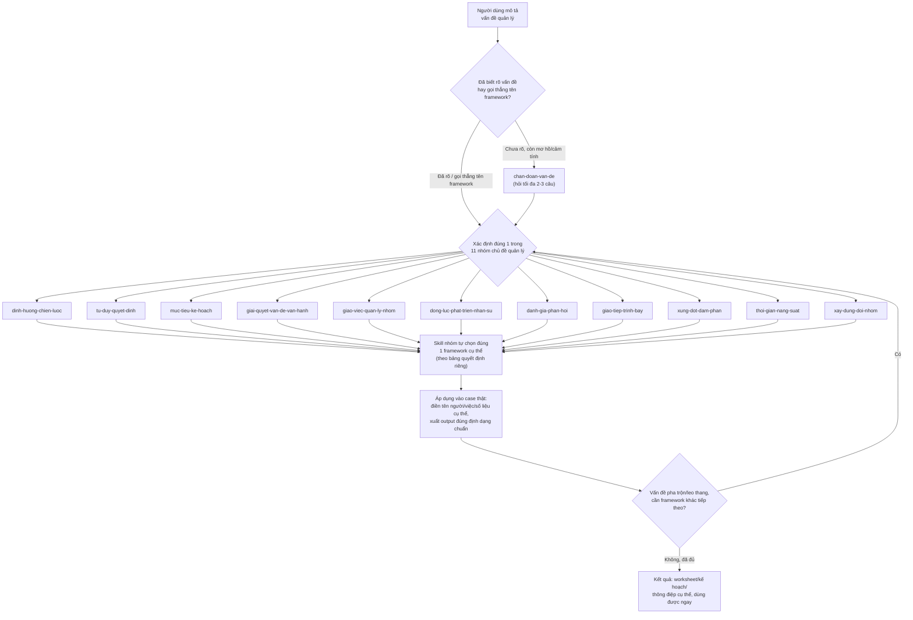

# Manager Frameworks Toolkit

Plugin cho Claude Code / Claude Cowork: chẩn đoán vấn đề quản lý còn mơ hồ, rồi tự chọn và áp dụng đúng 1 trong ~35 framework quản lý kinh điển vào chính tình huống thật của bạn — thay vì đưa lời khuyên chung chung.

**Mục lục**

1. [Tổng quan](#1-tổng-quan) — plugin là gì, dành cho ai, hoạt động ra sao, use case thực tế
2. [Cài đặt](#2-cài-đặt)
3. [Giới thiệu từng skill](#3-giới-thiệu-từng-skill) — 12 skill và các framework bên trong
4. [Nguồn gốc & lưu ý về độ chính xác](#4-nguồn-gốc--lưu-ý-về-độ-chính-xác)
5. [Kiến trúc](#5-kiến-trúc)

---

## 1. Tổng quan

### 1.1. Giới thiệu nhanh (5W1H)

**What — Đây là gì?**
Một plugin gồm 12 skill: 1 skill "chẩn đoán" (`chan-doan-van-de`) đóng vai trò cổng vào, và 11 skill theo nhóm chủ đề quản lý (chiến lược, ra quyết định, mục tiêu & kế hoạch, vận hành, giao việc, động lực nhân sự, đánh giá & phản hồi, giao tiếp, xung đột & đàm phán, thời gian, xây dựng đội nhóm). Mỗi skill nhóm chứa 1-7 framework kinh điển (SWOT, RACI, OKR, Six Thinking Hats, Minto Pyramid, Pomodoro...), tổng cộng ~35 framework.

**Why — Vì sao plugin này tồn tại?**
Phần lớn người quản lý (đặc biệt người không có nền tảng quản lý dự án/kinh doanh bài bản) biết mình "có vấn đề" nhưng không biết gọi tên đúng vấn đề đó, càng không biết framework nào phù hợp để xử lý. Hỏi thẳng AI một câu hỏi mơ hồ thường chỉ nhận lại lời khuyên chung chung, không dùng được ngay. Plugin này giải quyết đúng khoảng trống đó: tự chẩn đoán, tự chọn công cụ, tự áp dụng vào case thật — bạn không cần biết trước SWOT khác PESTEL ở đâu, hay khi nào nên dùng RACI thay vì Situational Leadership.

**Who — Dành cho ai?**
Quản lý ở mọi cấp (trưởng nhóm, trưởng phòng, founder), kể cả người **không có nền tảng quản lý/PM/BA bài bản** (ví dụ stakeholder tài chính đột nhiên phải quản lý một team dự án). Plugin luôn giải thích ký hiệu/thuật ngữ viết tắt ngay trong output, không giả định bạn đã biết trước.

**When — Khi nào nên dùng?**
- Khi bạn mô tả một vấn đề còn mơ hồ ("team dạo này kỳ kỳ", "họp hành cứ sao sao ấy", "không biết bắt đầu từ đâu").
- Khi bạn đã biết rõ vấn đề nhưng chưa chắc nên dùng framework nào.
- Khi bạn muốn dùng thẳng 1 framework đã biết tên (ví dụ "viết OKR cho team sales quý này").

Cả 3 trường hợp đều được xử lý — chỉ khác ở chỗ có cần bước chẩn đoán hay bỏ qua thẳng.

**Where — Dùng ở đâu?**
Chạy trong Claude Code hoặc Claude Cowork dưới dạng plugin cài qua marketplace (xem [mục 2](#2-cài-đặt)). Mỗi skill nhóm cũng dùng độc lập được nếu bạn gọi thẳng tên framework.

**How — Hoạt động ra sao?**
Theo cơ chế "chẩn đoán rồi định tuyến": skill cổng vào xác định đúng 1 trong 11 nhóm chủ đề, bàn giao cho skill nhóm đó tự chọn framework cụ thể theo bảng quyết định riêng, rồi áp dụng framework vào đúng bối cảnh bạn đưa ra (điền tên người/việc/số liệu cụ thể, không trả lời lý thuyết suông). Xem sơ đồ ngay bên dưới.

### 1.2. Cách hoạt động — Sơ đồ pipeline



Hai điểm đáng chú ý trong sơ đồ:

- **Có 2 điểm vào**: nếu vấn đề còn mơ hồ, luôn bắt đầu từ `chan-doan-van-de`; nếu đã rõ (hoặc gọi thẳng tên framework như "RACI", "OKR"), bỏ qua bước chẩn đoán và vào thẳng skill nhóm tương ứng.
- **Vòng lặp nối chuỗi**: sau khi áp dụng xong 1 framework, nếu vấn đề thực ra pha trộn nhiều lớp, plugin tự quay lại bước định tuyến để chọn tiếp framework phù hợp — không dừng lại giữa chừng khi vấn đề chưa thực sự được giải quyết.

### 1.3. Use case thực tế

**Use case 1 — Stakeholder tài chính, không có nền tảng PM/BA, cần phân vai cho team 3 người**

Một stakeholder phía tài chính phải trực tiếp quản lý team 3 người làm dự án quản lý task, không có PM hay BA hỗ trợ; team chồng chéo trách nhiệm — không rõ ai làm, ai chốt cuối, ai chỉ cần biết kết quả.

Luồng chạy: `chan-doan-van-de` → nhóm "Giao việc & Quản lý công việc nhóm" → `giao-viec-quan-ly-nhom` chọn **Ma trận RACI** → áp dụng vào đúng danh sách đầu việc và tên 3 thành viên.

*Điểm hay:* bản RACI đầu tiên chỉ hiện ký hiệu R/A/C/I mà không giải thích — khó hiểu nhất đúng lúc người dùng cần hiểu nhất. Lỗi này đã được vá vào skill: mọi output dùng ký hiệu viết tắt giờ luôn mở đầu bằng khối "Chú thích ký hiệu".

**Use case 2 — PM và backend developer bất đồng: theo nghiệp vụ user hay theo tính logic của hệ thống?**

Một dự án có 1 PM (đại diện nghiệp vụ "user") và 1 backend developer (builder chính). Nhiều nghiệp vụ của user "phi logic" theo góc nhìn hệ thống. Người ra quyết định đề ra nguyên tắc nhị phân (theo đúng nghiệp vụ dù phi logic, hoặc bắt user đổi nghiệp vụ) và muốn kiểm chứng lại trước khi họp.

Luồng chạy — minh hoạ khả năng nối chuỗi 3 framework:

1. `tu-duy-quyet-dinh` → **Six Thinking Hats** rà soát nguyên tắc nhị phân từ 6 góc độ, phát hiện lỗ hổng: đang áp một chính sách chung cho mọi case thay vì xét từng case.
2. `giao-tiep-trinh-bay` → **Minto Pyramid** đóng gói kết luận thành thông điệp mở đầu cuộc họp, đi thẳng vào kết luận.
3. Cuộc họp vẫn bế tắc vì hai niềm tin cốt lõi xung đột nhau (developer: "hệ thống nhất quán là ranh giới chuyên môn"; PM: "bảo vệ nghiệp vụ user là ưu tiên tuyệt đối") → quay lại `giao-tiep-trinh-bay` nhưng dùng **NLP Logical Levels** để xác định đúng tầng gốc rễ (Niềm tin & Giá trị, chạm Bản sắc — không phải tầng Hành vi) rồi đề xuất can thiệp đúng chỗ.

*Điểm hay:* không ai yêu cầu đúng 3 framework này theo đúng thứ tự — plugin tự nối chúng trong một luồng hội thoại liên tục.

---

## 2. Cài đặt

Repo này vừa là **1 plugin** (có `.claude-plugin/plugin.json` ở gốc) vừa là **1 marketplace tự trỏ vào chính nó** (có `.claude-plugin/marketplace.json`), nên cài trực tiếp từ GitHub bằng Claude Code:

```shell
# Bước 1 — thêm marketplace (thay <username>/<repo> bằng đường dẫn GitHub thật của repo này)
/plugin marketplace add <username>/<repo>

# Bước 2 — cài plugin từ marketplace vừa thêm
/plugin install manager-frameworks-toolkit@manager-frameworks-toolkit
```

Nếu Claude Code báo `Run /reload-plugins to activate.`, chạy thêm:

```shell
/reload-plugins
```

**Muốn thử trước khi cài chính thức?** Clone repo về máy rồi chạy trực tiếp:

```shell
git clone https://github.com/<username>/<repo>.git
claude --plugin-dir ./<repo>
```

**Kiểm tra đã cài thành công:** gõ `/plugin` để xem danh sách, hoặc thử ngay một câu mơ hồ như *"team mình dạo này kỳ kỳ, không biết bắt đầu từ đâu"* — skill `chan-doan-van-de` sẽ tự kích hoạt.

**Cách dùng sau khi cài:** không cần gõ lệnh đặc biệt. Chỉ cần mô tả tình huống bằng tiếng Việt như đang kể cho một người cố vấn; hoặc gọi thẳng tên framework ("làm RACI cho dự án này", "viết OKR cho team sales quý này").

---

## 3. Giới thiệu từng skill

Bảng tổng hợp để tra nhanh:

| # | Skill | Bạn đang gặp chuyện gì? | Framework bên trong |
|---|---|---|---|
| 0 | `chan-doan-van-de` | "Có gì đó không ổn nhưng không biết là gì" | Cổng vào — định tuyến sang 11 skill bên dưới |
| 1 | `dinh-huong-chien-luoc` | Cần định hướng, đánh giá thị trường, chọn hướng tăng trưởng | Golden Circle, SWOT, PESTEL, McKinsey 7S, Value Chain, Porter's Five Forces, Ansoff Matrix |
| 2 | `tu-duy-quyet-dinh` | Cần ra quyết định chắc chắn, tìm nguyên nhân gốc | Six Thinking Hats, 5W2H, 5 Whys, Gap Analysis, Cynefin, Sky-Rain-Umbrella, Pre-mortem |
| 3 | `muc-tieu-ke-hoach` | Mục tiêu mơ hồ, team lệch hướng, thiếu kế hoạch | SMART, OKR, GROW |
| 4 | `giai-quyet-van-de-van-hanh` | Vấn đề phức tạp/lặp lại, cần cải tiến hoặc dẫn dắt thay đổi lớn | McKinsey 7-step, Toyota 8-step, PDCA, Kotter 8-step |
| 5 | `giao-viec-quan-ly-nhom` | Giao việc không hiệu quả, trách nhiệm chồng chéo | 8 bước giao việc, RACI, Situational Leadership |
| 6 | `dong-luc-phat-trien-nhan-su` | Nhân viên mất động lực, biết mà không làm, hiểu lầm nhau | Tháp Maslow, Fogg Behavior Model, Johari Window |
| 7 | `danh-gia-phan-hoi` | Cần đánh giá thành tích hoặc góp ý hành vi | STAR, SBI |
| 8 | `giao-tiep-trinh-bay` | Báo cáo lan man, họp rút kinh nghiệm, mâu thuẫn sâu, nhiều bên liên quan | Minto Pyramid (+SCQA), ORID, NLP Logical Levels, Stakeholder Map |
| 9 | `xung-dot-dam-phan` | Xung đột giữa 2 người, cần đàm phán | LEAPS, Getting to Yes/BATNA |
| 10 | `thoi-gian-nang-suat` | Quá tải, trì hoãn, lịch bị chia vụn | Pomodoro, Eisenhower, GTD Weekly Review, Deep Work/Time-blocking |
| 11 | `xay-dung-doi-nhom` | Team mới lập hoặc đang chuyển đổi, không rõ nên quản thế nào | Tuckman's Stages |

Chi tiết từng skill:

### 3.0. `chan-doan-van-de` — Cổng vào chẩn đoán

**Giải quyết gì:** người quản lý hiếm khi đến với một vấn đề đã được gọi tên sẵn — họ đến với một *triệu chứng* ("họp hành cứ sao sao", "tôi mệt mỏi với team này"). Skill này làm việc của "bác sĩ đa khoa": quan sát triệu chứng và chuyển đúng "chuyên khoa" (1 trong 11 nhóm).

**Kích hoạt khi:** bạn mô tả vấn đề mơ hồ, cảm tính, hoặc nói thẳng là chưa biết vấn đề của mình là gì.

**Cách làm việc:** nếu đã rõ thì xác nhận nhóm chủ đề bằng 1 câu rồi bàn giao ngay; nếu mơ hồ thì hỏi **tối đa 2-3 câu** để thu hẹp (không phỏng vấn 20 câu). Bàn giao diễn ra liền mạch trong cùng một câu trả lời — bạn không phải tự chọn framework.

### 3.1. `dinh-huong-chien-luoc` — Định hướng & Chiến lược

**Giải quyết gì:** xây tầm nhìn/thông điệp, đánh giá thị trường trước khi mở rộng hoặc đầu tư, kiểm tra sức khỏe tổ chức, chọn hướng tăng trưởng.

| Framework | Dùng khi |
|---|---|
| **Golden Circle** (Why–How–What) | Không biết bắt đầu từ đâu; cần xây tầm nhìn, thông điệp, bài thuyết trình thuyết phục. |
| **SWOT** | Sắp ra quyết định lớn (mở rộng, đầu tư, sản phẩm mới) và muốn nhìn toàn cảnh điểm mạnh/yếu/cơ hội/rủi ro, cả nội bộ lẫn bên ngoài. |
| **PESTEL** | Cần đánh giá bối cảnh vĩ mô bên ngoài (chính trị, kinh tế, xã hội, công nghệ, môi trường, pháp lý) trước một quyết định lớn. |
| **McKinsey 7S** | Chiến lược/cơ cấu/con người không ăn khớp; chiến lược tốt nhưng thực thi kém; cần tái cấu trúc. |
| **Value Chain** (Porter) | Giá thành cao hơn đối thủ; muốn biết khâu nào tạo giá trị thật, khâu nào tốn chi phí thừa. |
| **Porter's Five Forces** | Chưa rõ một ngành có đáng gia nhập/đầu tư không, hoặc vì sao biên lợi nhuận bị ép bởi yếu tố bên ngoài. |
| **Ansoff Matrix** | Đã quyết định cần tăng trưởng nhưng phân vân: bán thêm cho khách cũ, mở thị trường mới, ra sản phẩm mới, hay đa dạng hóa. |

**Chuỗi hay dùng:** PESTEL → Five Forces → SWOT (từ vĩ mô, đến ngành, đến tổng hợp).

### 3.2. `tu-duy-quyet-dinh` — Tư duy & Ra quyết định

**Giải quyết gì:** các lỗi tư duy phổ biến — nhìn vấn đề từ một góc duy nhất, dừng ở nguyên nhân bề mặt, áp công thức cũ vào tình huống mới, kết luận mà không dựa trên dữ kiện.

| Framework | Dùng khi |
|---|---|
| **Six Thinking Hats** | Sợ bỏ sót rủi ro/cảm xúc đội nhóm; cần họp brainstorm đa chiều. |
| **5W2H** | Có một sự việc/sự cố nhưng chưa biết rõ bức tranh toàn cảnh; cần mô tả có cấu trúc theo 7 câu hỏi. |
| **5 Whys** | Đã biết vấn đề bề mặt, muốn hỏi liên tục "vì sao" để tìm nguyên nhân gốc. |
| **Gap Analysis** | Cần so sánh hiện trạng với trạng thái mong muốn trước khi lập kế hoạch. |
| **Cynefin** | Vấn đề phức tạp/mới/hỗn loạn; sợ áp nhầm "best practice" cứng nhắc. |
| **Sky-Rain-Umbrella** | Chuẩn bị báo cáo/đề xuất ngắn, muốn kiểm tra lập luận có bị nhảy cóc từ dữ kiện sang hành động không. |
| **Pre-mortem** | Sắp chốt một dự án/quyết định và muốn rà rủi ro bằng cách tưởng tượng nó đã thất bại rồi truy ngược nguyên nhân. |

**Chuỗi hay dùng:** 5W2H → 5 Whys (mô tả đầy đủ trước, đào sâu phần "Why" sau); Gap Analysis → SMART/OKR.

### 3.3. `muc-tieu-ke-hoach` — Đặt mục tiêu & Lập kế hoạch

**Giải quyết gì:** biến ý định mơ hồ thành mục tiêu rõ ràng hoặc kế hoạch hành động cụ thể.

| Framework | Dùng khi |
|---|---|
| **SMART** | Mục tiêu chưa rõ, chưa có con số hoặc deadline, khó biết khi nào coi là đạt. |
| **OKR** | Nhiều người kéo nhiều hướng, mỗi người chạy KPI riêng; cần một mục tiêu chung cho team/tổ chức theo quý. |
| **GROW** | Đã biết mục tiêu nhưng chưa biết làm sao đạt; cần đối thoại coaching 1-1 để tìm phương án. |

### 3.4. `giai-quyet-van-de-van-hanh` — Giải quyết vấn đề & Cải tiến vận hành

**Giải quyết gì:** chọn đúng quy trình giải quyết vấn đề theo *bản chất* của nó — chiến lược một lần, lỗi vận hành lặp lại, cải tiến liên tục, hay thay đổi cấp tổ chức.

| Framework | Dùng khi |
|---|---|
| **McKinsey 7-step** | Vấn đề kinh doanh phức tạp, đã thử nhiều lần chưa dứt điểm, cần quyết định chiến lược. |
| **Toyota 8-step** | Lỗi/sự cố tái diễn nhiều lần; cần xử lý tận gốc và chuẩn hóa để không lặp lại. |
| **PDCA** | Muốn cải thiện dần một quy trình qua nhiều vòng thử nghiệm — đo lường — điều chỉnh. |
| **Kotter 8-step** | Dẫn dắt thay đổi lớn ở cấp tổ chức (tái cấu trúc, đổi văn hoá, sáp nhập, đổi hệ thống) và đang gặp phản kháng. |

### 3.5. `giao-viec-quan-ly-nhom` — Giao việc & Quản lý công việc nhóm

**Giải quyết gì:** giao việc mà không ai làm đúng ý; dự án nhiều người nhưng không rõ ai làm gì; phân vân giữa kiểm soát và trao quyền.

| Framework | Dùng khi |
|---|---|
| **8 bước giao việc** | Đã giao việc nhưng người đó không làm/làm sai/làm trễ. |
| **RACI** | Dự án nhiều người, không rõ ai làm, ai quyết cuối cùng, ai cần được hỏi ý kiến, ai chỉ cần biết kết quả. |
| **Situational Leadership** | Không chắc nên chỉ đạo sát hay trao quyền cho một nhân viên với một việc cụ thể. |

### 3.6. `dong-luc-phat-trien-nhan-su` — Tạo động lực & Phát triển nhân sự

**Giải quyết gì:** nhân viên mất động lực; biết và muốn làm nhưng vẫn không làm; đội nhóm hiểu lầm nhau.

| Framework | Dùng khi |
|---|---|
| **Tháp nhu cầu Maslow** | Nhân viên/đội nhóm sa sút tinh thần, chán nản, thiếu chủ động — cần xác định đang thiếu hụt ở tầng nhu cầu nào. |
| **Fogg Behavior Model** (B=MAP) | Đã đồng ý, hiểu rõ việc cần làm nhưng vẫn quên/trì hoãn — kiểm tra thiếu Động lực, Khả năng hay Lời nhắc. |
| **Cửa sổ Johari** | Giao tiếp trong nhóm thiếu cởi mở, nhiều hiểu lầm; muốn biết người khác nhìn mình thế nào. |

### 3.7. `danh-gia-phan-hoi` — Đánh giá hiệu suất & Phản hồi

**Giải quyết gì:** đánh giá và phản hồi dựa trên dẫn chứng cụ thể thay vì nhận xét chung chung.

| Framework | Dùng khi |
|---|---|
| **STAR** (Situation–Task–Action–Result) | Chuẩn bị phỏng vấn (đặt câu hỏi hành vi cho ứng viên) hoặc viết đánh giá thành tích nhân viên cần dẫn chứng rõ ràng. |
| **SBI** (Situation–Behavior–Impact) | Cần góp ý một hành vi cụ thể, đặc biệt phản hồi khó/tiêu cực, hoặc nhân viên hay phản ứng gay gắt khi bị góp ý. |

### 3.8. `giao-tiep-trinh-bay` — Giao tiếp & Trình bày ý tưởng

**Giải quyết gì:** nhiều vấn đề "giao tiếp kém" thực ra là thiếu cấu trúc — báo cáo lan man, họp rút kinh nghiệm biến thành đổ lỗi, mâu thuẫn bị xử lý sai tầng, hay bỏ sót bên liên quan quan trọng.

| Framework | Dùng khi |
|---|---|
| **Minto Pyramid** (kèm SCQA) | Cần trình bày/viết báo cáo đi thẳng vào kết luận, không lan man. SCQA là kỹ thuật mở đầu nằm bên trong Minto. |
| **ORID** | Cần dẫn dắt một cuộc họp rút kinh nghiệm/debrief có cấu trúc, đi từ sự kiện khách quan đến quyết định. |
| **NLP Logical Levels** | Mâu thuẫn/vấn đề có vẻ sâu hơn bề mặt hành vi; cần xác định đúng tầng vấn đề trước khi can thiệp. |
| **Stakeholder Map** (Quyền lực × Quan tâm) | Dự án/thay đổi có nhiều bên liên quan; cần biết ai phải quản lý sát, ai chỉ cần thông báo. |

**Chuỗi hay dùng:** Stakeholder Map → Minto (biết ai cần nghe gì rồi mới soạn thông điệp). Lưu ý Minto đi *top-down* (kết luận trước) còn ORID đi *bottom-up* (sự kiện trước) — đừng dùng nhầm chỗ.

### 3.9. `xung-dot-dam-phan` — Giải quyết xung đột & Đàm phán

**Giải quyết gì:** hàn gắn quan hệ khi có mâu thuẫn cảm xúc; chuẩn bị đàm phán khi hai bên có lợi ích khác nhau.

| Framework | Dùng khi |
|---|---|
| **LEAPS** | Có xung đột/mâu thuẫn cảm xúc giữa 2 người (2 nhân viên, hoặc quản lý với nhân viên) cần hàn gắn trước khi bàn giải pháp. |
| **Getting to Yes / BATNA** | Cần chuẩn bị hoặc đang trong một cuộc đàm phán mà lợi ích hai bên khác nhau. |

### 3.10. `thoi-gian-nang-suat` — Quản lý thời gian & Năng suất cá nhân

**Giải quyết gì:** vật lộn với tập trung, ưu tiên, và việc tồn đọng.

| Framework | Dùng khi |
|---|---|
| **GTD Weekly Review** | Luôn cảm giác có việc đang bị bỏ sót; email/ghi chú/dự án tồn đọng không kiểm soát được. |
| **Ma trận Eisenhower** | Nhiều việc cùng lúc, không biết ưu tiên việc nào, luôn cảm thấy chỉ đang chữa cháy. |
| **Deep Work / Time-blocking** | Lịch bị họp hành và việc nông chiếm hết, không có khối vài giờ liền để làm việc cần tư duy sâu. |
| **Pomodoro** | Khó tập trung/hay bị gián đoạn khi làm một việc cụ thể. |

**Chuỗi hay dùng:** GTD (gom việc) → Eisenhower (chọn ưu tiên) → Deep Work (dành khối thời gian) → Pomodoro (giữ tập trung trong khối đó).

### 3.11. `xay-dung-doi-nhom` — Xây dựng & Phát triển đội nhóm

**Giải quyết gì:** cách quản lý đúng ở giai đoạn này có thể phản tác dụng ở giai đoạn khác — ví dụ trao quyền quá sớm cho team mới lập khiến team càng rối. Skill chẩn đoán team đang ở giai đoạn nào trước khi chọn hành động.

| Framework | Dùng khi |
|---|---|
| **Tuckman's Stages** (Forming–Storming–Norming–Performing–Adjourning) | Team mới thành lập, đang có xung đột nội bộ, vừa có thay đổi lớn, hoặc bạn không chắc nên chỉ đạo sát hay buông tay. |

---

## 4. Nguồn gốc & lưu ý về độ chính xác

Phần lớn framework đến từ cuốn sách "Tư duy & Phương pháp Quản lý Đúng" (video + ảnh người dùng cung cấp) và các nguồn kinh điển đã được kiểm chứng. Một số điểm cần lưu ý (đã ghi chú trực tiếp trong các file `references/` liên quan):

- **8 bước giao việc**: quy trình tổng hợp theo sách nguồn, không phải mô hình học thuật kinh điển.
- **5 Whys**: một số tài liệu (kể cả nguồn sách) gọi nhầm là "Nguyên lý thứ nhất" — tên đúng và phổ biến quốc tế là 5 Whys, khác với First Principles Thinking thật.
- **LEAPS**: không phải mô hình học thuật có định nghĩa thống nhất duy nhất — dùng như khung gợi ý thực dụng, không phải công thức cứng.
- **Sky-Rain-Umbrella**: heuristic phổ biến trong tư vấn quản lý Nhật Bản, nguồn gốc/tác giả cụ thể không được xác nhận chính thức.
- **Fogg Behavior Model**: dùng thuật ngữ hiện tại B=MAP (Motivation-Ability-Prompt); yếu tố thứ 3 trước đây gọi là "Trigger" (B=MAT).
- **SCQA**: là kỹ thuật mở đầu bên trong Minto Pyramid, không phải framework tách biệt.
- **NLP Logical Levels**: phổ biến trong NLP/coaching, không có mức kiểm chứng thực nghiệm như các mô hình tâm lý học hàn lâm — dùng như công cụ đặt câu hỏi, không phải lý thuyết đã được chứng minh. Plugin luôn nêu kết quả là *giả thuyết cần xác nhận lại với người liên quan*.
- **Porter's Five Forces, Ansoff Matrix, Pre-mortem, Stakeholder Map**: 4 framework bổ sung sau bản đầu (từ việc rà soát repo `phuryn/pm-skills`), không nằm trong nguồn sách gốc — thêm vào vì là các framework kinh điển, đủ tổng quát cho phạm vi "quản lý con người & vận hành".
- **GTD Weekly Review, Deep Work/Time-blocking**: 2 framework bổ sung tiếp theo (từ việc rà soát repo `alirezarezvani/claude-skills`), thuộc nhóm `thoi-gian-nang-suat` (David Allen, Cal Newport).

**Nguyên tắc chung của mọi skill:** không bịa dữ kiện/số liệu khi framework cần dữ liệu thật; luôn gắn framework vào case cụ thể của bạn; nêu rõ đang dùng framework nào và vì sao (để bạn tự học cách chọn cho lần sau); luôn giải thích ký hiệu viết tắt ngay trong output.

---

## 5. Kiến trúc

```
manager-frameworks-toolkit/
├── .claude-plugin/
│   ├── plugin.json          # manifest của plugin
│   └── marketplace.json     # marketplace tự trỏ vào chính repo này
├── README.md
└── skills/
    ├── chan-doan-van-de/        # cổng vào (SKILL.md + references/nhom-van-de.md)
    ├── dinh-huong-chien-luoc/   # mỗi skill nhóm: SKILL.md + references/<framework>.md
    ├── tu-duy-quyet-dinh/
    ├── muc-tieu-ke-hoach/
    ├── giai-quyet-van-de-van-hanh/
    ├── giao-viec-quan-ly-nhom/
    ├── dong-luc-phat-trien-nhan-su/
    ├── danh-gia-phan-hoi/
    ├── giao-tiep-trinh-bay/
    ├── xung-dot-dam-phan/
    ├── thoi-gian-nang-suat/
    └── xay-dung-doi-nhom/
```

Plugin dùng kiến trúc "chẩn đoán rồi định tuyến theo nhóm chủ đề" thay vì 1 skill duy nhất chứa toàn bộ ~35 framework, hoặc ~35 skill riêng lẻ — mục tiêu là cân bằng giữa việc tránh trigger nhầm lẫn giữa quá nhiều skill có mô tả gần giống nhau, và tránh 1 `SKILL.md` quá dài khó bảo trì. Mỗi framework nằm trong file `references/` riêng với cấu trúc cố định: *Định nghĩa → Input cần thu thập → Output theo đúng cấu trúc → Ví dụ rút gọn*, và chỉ được đọc khi skill nhóm đã chọn đúng framework đó.
