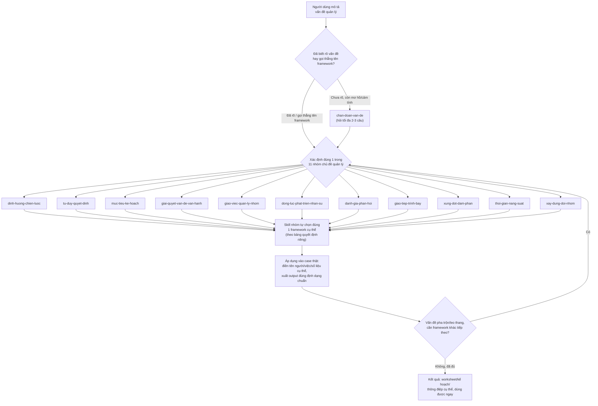

# Manager Frameworks Toolkit

Plugin cho Claude Code / Claude Cowork: chẩn đoán vấn đề quản lý còn mơ hồ, rồi tự chọn và áp dụng đúng 1 trong ~35 framework quản lý kinh điển vào chính tình huống thật của bạn — thay vì đưa lời khuyên chung chung.

## 1. Giới thiệu (5W1H)

**What — Đây là gì?**
Một plugin gồm 12 skill: 1 skill "chẩn đoán" (`chan-doan-van-de`) đóng vai trò cổng vào, và 11 skill theo nhóm chủ đề quản lý (chiến lược, ra quyết định, mục tiêu & kế hoạch, vận hành, giao việc, động lực nhân sự, đánh giá & phản hồi, giao tiếp, xung đột & đàm phán, thời gian, xây dựng đội nhóm), mỗi skill nhóm chứa 2-7 framework kinh điển (SWOT, RACI, OKR, Six Thinking Hats, Minto Pyramid, Pomodoro...). Tổng cộng ~35 framework.

**Why — Vì sao plugin này tồn tại?**
Phần lớn người quản lý (đặc biệt người không có nền tảng quản lý dự án/kinh doanh bài bản) biết mình "có vấn đề" nhưng không biết gọi tên đúng vấn đề đó, càng không biết framework nào phù hợp để xử lý. Hỏi thẳng AI một câu hỏi mơ hồ thường chỉ nhận lại lời khuyên chung chung, không dùng được ngay. Plugin này giải quyết đúng khoảng trống đó: tự chẩn đoán, tự chọn công cụ, tự áp dụng vào case thật — người dùng không cần biết trước SWOT khác PESTEL ở đâu, hay khi nào nên dùng RACI thay vì Situational Leadership.

**Who — Dành cho ai?**
Quản lý ở mọi cấp (trưởng nhóm, trưởng phòng, founder), kể cả người **không có nền tảng quản lý/PM/BA bài bản** (ví dụ stakeholder tài chính đột nhiên phải quản lý một team dự án) — plugin luôn giải thích ký hiệu/thuật ngữ viết tắt ngay trong output, không giả định người dùng đã biết trước.

**When — Khi nào nên dùng?**
Khi bạn mô tả một vấn đề quản lý còn mơ hồ ("team dạo này kỳ kỳ", "họp hành cứ sao sao ấy", "không biết bắt đầu từ đâu"); khi bạn đã biết rõ vấn đề nhưng chưa chắc nên dùng framework nào; hoặc khi bạn muốn dùng thẳng 1 framework cụ thể đã biết tên (ví dụ "viết OKR cho team sales quý này") — cả 3 trường hợp đều được xử lý, chỉ khác ở việc có cần bước chẩn đoán hay bỏ qua thẳng.

**Where — Dùng ở đâu?**
Chạy trong Claude Code hoặc Claude Cowork dưới dạng plugin cài qua marketplace (xem mục Cài đặt bên dưới). Mỗi skill nhóm cũng có thể dùng độc lập nếu bạn gọi thẳng tên framework.

**How — Hoạt động ra sao?**
Theo cơ chế "chẩn đoán rồi định tuyến": skill cổng vào xác định đúng 1 trong 11 nhóm chủ đề, bàn giao cho skill nhóm đó tự chọn framework cụ thể theo bảng quyết định riêng, rồi áp dụng framework đó vào đúng bối cảnh người dùng đưa ra (điền tên người/việc/số liệu cụ thể, không trả lời lý thuyết suông). Xem sơ đồ đầy đủ ở mục 2.

## 2. Cách hoạt động — Sơ đồ pipeline



Hai điểm đáng chú ý trong sơ đồ:

- **Có 2 điểm vào**: nếu vấn đề còn mơ hồ, luôn bắt đầu từ `chan-doan-van-de`; nếu đã rõ (hoặc gọi thẳng tên framework như "RACI", "OKR"), bỏ qua bước chẩn đoán và vào thẳng skill nhóm tương ứng.
- **Vòng lặp nối chuỗi**: sau khi áp dụng xong 1 framework, nếu vấn đề thực ra pha trộn nhiều lớp (ví dụ vừa cần rà soát quyết định vừa cần soạn thông điệp họp vừa cần chẩn đoán mâu thuẫn giá trị sâu hơn), plugin tự quay lại bước định tuyến để chọn tiếp framework phù hợp — không dừng lại giữa chừng khi vấn đề chưa thực sự được giải quyết. Use case 2 bên dưới minh hoạ đúng vòng lặp này qua 3 framework liên tiếp.

## 3. Use case thực tế

### Use case 1 — Stakeholder tài chính, không có nền tảng PM/BA, cần phân vai cho team 3 người

**Bối cảnh**: một stakeholder phía tài chính, không có nền tảng quản lý dự án, phải trực tiếp quản lý một team 3 người làm dự án quản lý task — không có PM hay BA hỗ trợ. Team đang chồng chéo trách nhiệm: không rõ ai làm, ai chốt cuối, ai chỉ cần biết kết quả.

**Luồng chạy**: `chan-doan-van-de` xác định đây là vấn đề nhóm "Giao việc & Quản lý công việc nhóm" → bàn giao cho `giao-viec-quan-ly-nhom` → skill chọn **Ma trận RACI** (đúng bài toán "nhiều người, nhiều đầu việc, không rõ vai trò") → áp dụng vào đúng danh sách đầu việc và tên 3 thành viên team.

**Điểm hay**: trong lần chạy thử đầu tiên, output RACI ban đầu chỉ hiện các ký hiệu R/A/C/I mà không giải thích — với người dùng không có nền tảng quản lý, đây là một bảng khó hiểu ngay chính lúc cần hiểu nhất. Lỗi này đã được vá thẳng vào skill: mọi output RACI (và mọi framework dùng ký hiệu viết tắt trong plugin) giờ luôn mở đầu bằng một khối "Chú thích ký hiệu" giải thích ngắn gọn trước khi đưa bảng ra.

### Use case 2 — PM và backend developer bất đồng: theo đúng nghiệp vụ user hay theo tính logic của hệ thống?

**Bối cảnh**: một dự án quản lý task có 1 PM (đại diện nghiệp vụ "user") và 1 backend developer (builder chính). Cả hai phát hiện nhiều nghiệp vụ của user "phi logic" theo góc nhìn hệ thống. Người ra quyết định đã tự đề ra một nguyên tắc nhị phân: (1) theo đúng nghiệp vụ dù phi logic, hoặc (2) bắt user đổi nghiệp vụ cho logic — và muốn kiểm chứng lại nguyên tắc này trước khi họp với cả team.

**Luồng chạy — minh hoạ rõ nhất khả năng "nối chuỗi nhiều framework" của plugin**:

1. `chan-doan-van-de` → `tu-duy-quyet-dinh` → **Six Thinking Hats** rà soát nguyên tắc nhị phân ban đầu từ 6 góc độ, phát hiện lỗ hổng: đang áp một chính sách chung cho mọi case thay vì xét từng case cụ thể.
2. Ngay sau đó, plugin tự gợi ý và chuyển sang `giao-tiep-trinh-bay` → **Minto Pyramid Principle** để đóng gói kết luận thành một thông điệp mở đầu cuộc họp, đi thẳng vào kết luận thay vì kể lể.
3. Khi cuộc họp thực tế vẫn bế tắc — không còn là bất đồng về hành vi/quy trình mà là hai niềm tin cốt lõi xung đột nhau (developer: "hệ thống nhất quán là ranh giới chuyên môn không thể thoả hiệp"; PM: "bảo vệ đúng nghiệp vụ của user là ưu tiên không thể nhân nhượng") — quay lại đúng skill `giao-tiep-trinh-bay` nhưng lần này dùng **NLP Logical Levels** để xác định đúng tầng gốc rễ (Niềm tin & Giá trị, chạm cả Bản sắc — không phải tầng Hành vi), từ đó đề xuất can thiệp đúng chỗ thay vì tiếp tục tranh luận ở tầng sai.

**Điểm hay**: không ai yêu cầu dùng đúng 3 framework này theo đúng thứ tự — plugin tự nối chúng lại trong một luồng hội thoại liên tục, kể cả khi phải quay lại đúng một skill nhóm lần thứ hai cho một framework khác vì tình huống thực tế đã đổi.

## 4. 11 nhóm chủ đề & framework bên trong

| Skill | Nhóm chủ đề | Framework bên trong |
|---|---|---|
| `dinh-huong-chien-luoc` | Định hướng & Chiến lược | Golden Circle, SWOT, PESTEL, McKinsey 7S, Value Chain, Porter's Five Forces, Ansoff Matrix |
| `tu-duy-quyet-dinh` | Tư duy & Ra quyết định | Six Thinking Hats, 5W2H, 5 Whys, Gap Analysis, Cynefin, Sky-Rain-Umbrella, Pre-mortem |
| `muc-tieu-ke-hoach` | Đặt mục tiêu & Lập kế hoạch | SMART, OKR, GROW |
| `giai-quyet-van-de-van-hanh` | Giải quyết vấn đề & Cải tiến vận hành | McKinsey 7-step, Toyota 8-step, PDCA, Kotter 8-step |
| `giao-viec-quan-ly-nhom` | Giao việc & Quản lý công việc nhóm | 8 bước giao việc, RACI, Situational Leadership |
| `dong-luc-phat-trien-nhan-su` | Tạo động lực & Phát triển nhân sự | Tháp Maslow, Fogg Behavior Model, Johari Window |
| `danh-gia-phan-hoi` | Đánh giá hiệu suất & Phản hồi | STAR, SBI Feedback Model |
| `giao-tiep-trinh-bay` | Giao tiếp & Trình bày ý tưởng | Minto Pyramid (gồm SCQA), ORID, NLP Logical Levels, Stakeholder Map |
| `xung-dot-dam-phan` | Giải quyết xung đột & Đàm phán | LEAPS, Getting to Yes/BATNA |
| `thoi-gian-nang-suat` | Quản lý thời gian & Năng suất cá nhân | Pomodoro, Eisenhower Matrix, GTD Weekly Review, Deep Work/Time-blocking |
| `xay-dung-doi-nhom` | Xây dựng & Phát triển đội nhóm | Tuckman's Stages |

## 5. Cài đặt

Repo này vừa là **1 plugin** (có `.claude-plugin/plugin.json` ở gốc) vừa là **1 marketplace tự trỏ vào chính nó** (có `.claude-plugin/marketplace.json`), nên có thể cài trực tiếp từ GitHub bằng Claude Code:

```shell
# Bước 1 — thêm marketplace (thay <username>/<repo> bằng đường dẫn GitHub thật của bạn)
/plugin marketplace add <username>/<repo>

# Bước 2 — cài plugin từ marketplace vừa thêm
/plugin install manager-frameworks-toolkit@manager-frameworks-toolkit
```

Sau khi cài, nếu Claude Code báo `Run /reload-plugins to activate.`, chạy thêm:

```shell
/reload-plugins
```

Muốn thử trước khi cài chính thức? Clone repo về máy rồi chạy trực tiếp:

```shell
claude --plugin-dir ./manager-frameworks-toolkit
```

## 6. Nguồn gốc & lưu ý về độ chính xác

Phần lớn framework đến từ cuốn sách "Tư duy & Phương pháp Quản lý Đúng" (video + ảnh người dùng cung cấp) và các nguồn kinh điển đã được kiểm chứng. Một số điểm cần lưu ý (đã ghi chú trực tiếp trong các file `references/` liên quan):

- **5 Whys**: một số tài liệu (bao gồm nguồn sách) gọi nhầm kỹ thuật này là "Nguyên lý thứ nhất" — tên đúng và phổ biến quốc tế là 5 Whys, khác với First Principles Thinking thật.
- **LEAPS**: không phải một mô hình học thuật có định nghĩa thống nhất duy nhất — dùng như khung gợi ý thực dụng, không phải công thức cứng.
- **Sky-Rain-Umbrella**: một heuristic phổ biến trong tư vấn quản lý Nhật Bản, nguồn gốc/tác giả cụ thể không được xác nhận chính thức.
- **Fogg Behavior Model**: dùng thuật ngữ hiện tại B=MAP (Motivation-Ability-Prompt); yếu tố thứ 3 trước đây gọi là "Trigger" (B=MAT), sau đổi thành "Prompt".
- **SCQA**: là kỹ thuật mở đầu bên trong Minto Pyramid Principle, không phải một framework tách biệt — được gộp vào `giao-tiep-trinh-bay/references/minto-pyramid.md`.
- **NLP Logical Levels**: phổ biến trong tài liệu NLP/coaching, không có cùng mức kiểm chứng khoa học thực nghiệm như các mô hình tâm lý học hàn lâm — dùng như công cụ đặt câu hỏi, không phải lý thuyết đã được chứng minh.
- **Porter's Five Forces, Ansoff Matrix, Pre-mortem, Stakeholder Map**: 4 framework bổ sung sau bản đầu (từ việc rà soát repo `phuryn/pm-skills`), không nằm trong nguồn sách gốc — được thêm vào vì đây là các framework chiến lược/tư duy/giao tiếp kinh điển, đủ tổng quát để phù hợp với phạm vi "quản lý con người & vận hành" của plugin.
- **GTD Weekly Review, Deep Work/Time-blocking**: 2 framework bổ sung tiếp theo (từ việc rà soát repo `alirezarezvani/claude-skills`), thêm vào nhóm `thoi-gian-nang-suat` — cũng là framework năng suất cá nhân kinh điển (David Allen, Cal Newport).

## 7. Kiến trúc

Plugin dùng kiến trúc "chẩn đoán rồi định tuyến theo nhóm chủ đề" thay vì 1 skill duy nhất chứa toàn bộ ~35 framework, hoặc ~35 skill riêng lẻ theo từng framework — mục tiêu là cân bằng giữa việc tránh trigger nhầm lẫn giữa quá nhiều skill mô tả gần giống nhau, và tránh 1 SKILL.md quá dài khó bảo trì.
